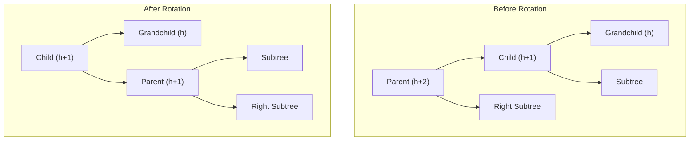

## Tree

### Segment Tree

**What is a Segment Tree?**

A Segment Tree is a versatile binary tree data structure used for storing intervals or segments. It allows answering range queries over an array—such as finding the sum, minimum, maximum, or greatest common divisor within a specified index range $[L, R]$—in $O(\log N)$ time, while also supporting point updates (or range updates via lazy propagation) in $O(\log N)$ time.

In a traditional engineering context, we compare a Segment Tree against simpler alternatives:

- **Naive Array:** Point updates take $O(1)$ time, but range queries take $O(N)$ time.
- **Prefix Sum Array:** Range queries take $O(1)$ time, but updating a single element takes $O(N)$ time because all subsequent prefix sums must be recomputed.
- **Segment Tree:** Bridges this gap by organizing the data hierarchically, guaranteeing $O(\log N)$ time complexity for both operations.

**Explanation of the Mechanics**

**1. Building the Tree (Build)**

We divide the array into halves recursively until we reach individual elements ($L == R$). These become the leaf nodes. As recursion unwinds, parent nodes calculate their aggregate value by summing the values of their left and right children:

$$
\text{node}\rightarrow\text{sum} = \text{left child}\rightarrow\text{sum} + \text{right child}\rightarrow\text{sum}
$$

- **Time Complexity:** $O(N)$ because exactly $2N - 1$ nodes are created.
- **Space Complexity:** $O(N)$ heap memory to store the tree nodes.

**2. Range Sum Query (QueryHelper)**

When querying a range $[L, R]$, every node we visit falls into one of three distinct categories:

- **Total Overlap:** The node's entire interval $[\text{start}, \text{end}]$ lies within $[L, R]$. We immediately return `node->sum` without exploring its children.
- **No Overlap:** The node's interval is completely outside $[L, R]$. We return the identity value (0 for addition).
- **Partial Overlap:** The interval partially intersects $[L, R]$. We recursively call the helper on both children and sum their returns.
- **Time Complexity:** $O(\log N)$ because at most 4 nodes are visited at any given depth of the tree.

**3. Point Update (UpdateHelper)**

To change an element at `target_index`, we traverse down the tree following the branch that contains the target index (comparing `target_index` against `mid`). Once the leaf is updated, we update every parent node's sum as we return up the call stack.

- **Time Complexity:** $O(\log N)$ corresponding exactly to the height of the tree.

**Pseudocode**

**1. Build Operation**

```
function Build(data, start, end):
    node = new Node(start, end)

    // Base case: Leaf node
    if start == end:
        node.sum = data[start]
        return node

    // Recursive case: Internal node
    mid = start + (end - start) / 2
    node.left_child = Build(data, start, mid)
    node.right_child = Build(data, mid + 1, end)

    // Combine
    node.sum = node.left_child.sum + node.right_child.sum
    return node
```

**2. Query Operation**

```
function Query(node, query_left, query_right):
    // 1. No Overlap
    if node.end < query_left or node.start > query_right:
        return 0

    // 2. Total Overlap
    if node.start >= query_left and node.end <= query_right:
        return node.sum

    // 3. Partial Overlap
    left_sum = Query(node.left_child, query_left, query_right)
    right_sum = Query(node.right_child, query_left, query_right)

    return left_sum + right_sum
```

**3. Update Operation**

```
function Update(node, target_index, new_value):
    // Base case: Reached the exact leaf node
    if node.start == node.end:
        node.sum = new_value
        return

    mid = node.start + (node.end - node.start) / 2

    // Route to the correct child
    if target_index <= mid:
        Update(node.left_child, target_index, new_value)
    else:
        Update(node.right_child, target_index, new_value)

    // Recalculate parent sum during backtracking
    node.sum = node.left_child.sum + node.right_child.sum
```

### Binary Search Tree

### AVL Tree

**What is an AVL Tree?**

An **AVL Tree** (named after inventors Adelson-Velsky and Landis) is a self-balancing binary search tree (BST). In a standard binary search tree, operations like search, insertion, and deletion can degrade to $O(N)$ time complexity if the tree becomes skewed (resembling a linked list). An AVL tree solves this by strictly maintaining its height balance.

For every node in an AVL tree, the heights of its left and right subtrees can differ by at most **1**. This property is tracked using the **Balance Factor**:

$\text{Balance Factor} = \text{Height}(\text{Left Subtree}) - \text{Height}(\text{Right Subtree})$

If the balance factor of any node falls outside the range $[-1, 1]$ after an insertion or deletion, the tree performs structural rotations to restore balance, guaranteeing $O(\log N)$ time complexity for all core operations.

**Architectural Mechanics & Rotations**

When an imbalance occurs, the tree rebalances itself using four types of rotations, categorized based on where the insertion or deletion occurred relative to the unbalanced node:

1. **Left-Left (LL) Case:** Fixed via a single **Right Rotation**.
2. **Right-Right (RR) Case:** Fixed via a single **Left Rotation**.
3. **Left-Right (LR) Case:** Fixed via a **Left Rotation on the child**, followed by a **Right Rotation on the grandparent**.
4. **Right-Left (RL) Case:** Fixed via a **Right Rotation on the child**, followed by a **Left Rotation on the grandparent**.

**Mermaid Diagram: Single Right Rotation (LL Case)**

Code snippet



**Height Management & Rebalancing Logic**

**1. Height Calculation**

Unlike naive height increments, AVL trees explicitly maintain accurate heights using the standard recurrence relation:

$\text{Height} = 1 + \max(\text{Left Height}, \text{Right Height})$

**2. Insertion Rebalancing**

When a node is inserted, the algorithm bubbles back up to the root via parent pointers (`node = node->parent`). At each step:

- The node's height is updated.
- The child height difference is checked. If it exceeds 1, rotations are triggered to restore balance.

**3. Deletion Rebalancing**

Deletion is more complex than insertion because removing a node can cause multiple imbalances propagating all the way up to the root.

- **If the deleted node has $\leq 1$ child:** Rebalancing starts from the **parent** of the deleted node.
- **If the deleted node has 2 children:** Rebalancing starts from the **successor's parent** (or the successor node itself, depending on whether its parent is the deleted node).